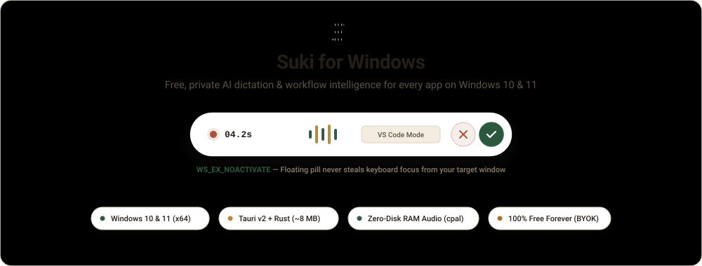
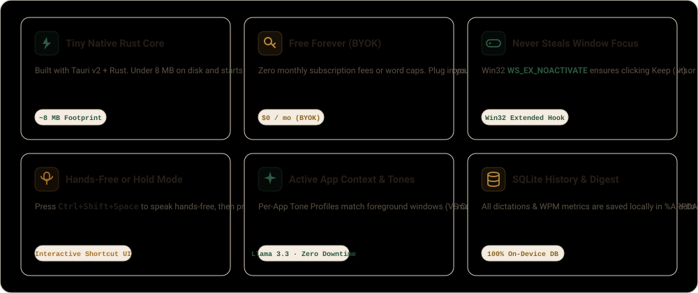
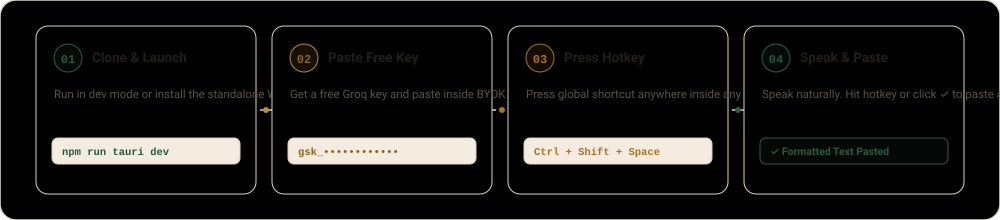
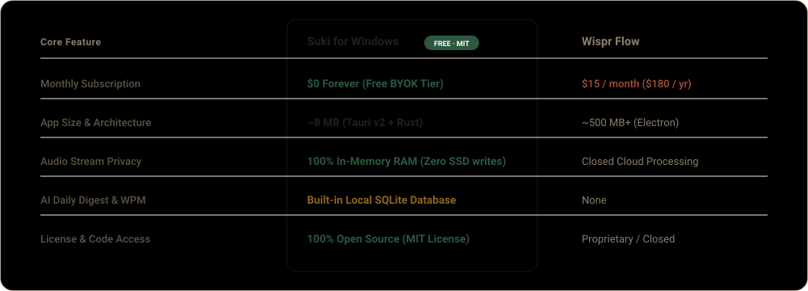

<div align="center">

<a href="https://github.com/imVVerma/Suki-For-Win">
  <picture>
    <source media="(prefers-color-scheme: dark)" srcset="docs/assets/readme/hero-dark.svg">
    
  </picture>
</a>

<br>

<picture>
  <source media="(prefers-color-scheme: dark)" srcset="docs/assets/readme/features-dark.svg">
  
</picture>

<br><br>

<picture>
  <source media="(prefers-color-scheme: dark)" srcset="docs/assets/readme/steps-dark.svg">
  
</picture>

<p align="center">
  <a href="https://console.groq.com/keys"><b>Get a free Groq key →</b></a>
</p>

<br>

<picture>
  <source media="(prefers-color-scheme: dark)" srcset="docs/assets/readme/compare-dark.svg">
  
</picture>

</div>

<br>

---

## 🚀 Quick Start (Run Locally on Windows 10 / 11)

Clone and launch **Suki-Win** in under 2 minutes:

```powershell
git clone https://github.com/imVVerma/Suki-For-Win.git
cd Suki-For-Win
npm install
npm run tauri dev
```

<details>
<summary><b>🛠️ First-Time Prerequisites, Architecture &amp; Building a Standalone <code>.exe</code> (Click to expand)</b></summary>

<br>

### 1️⃣ Prerequisites (One-Time Setup)
1. **[Node.js (v18+)](https://nodejs.org/)** — Verify with `node -v`.
2. **[Rust Toolchain (`rustup`)](https://rustup.rs/)** — Install via `rustup-init.exe`.
3. **[Microsoft C++ Build Tools](https://visualstudio.microsoft.com/visual-cpp-build-tools/)** (or MinGW GCC via MSYS2).
4. **[Free Groq API Key](https://console.groq.com/keys)** — Paste your `gsk_...` key inside the **BYOK Settings** tab on launch.

---

### 2️⃣ Under the Hood: Windows Architecture
```text
suki-win/
├── src/
│   ├── main.tsx                 # Multi-window router (Dashboard vs. Floating HUD)
│   └── components/
│       ├── Dashboard.tsx        # 960x680px Warm Obsidian History feed, WPM analytics, Daily Digest & Settings
│       ├── FloatingHud.tsx      # 260x48px Non-activating pill (WS_EX_NOACTIVATE) with ✓ Keep & ✕ Discard
│       ├── SukiLogo.tsx         # Signature geometric Braun S-Equalizer vector mark
│       └── LogoShowcase.tsx     # Brand Identity Lab preview drawer
└── src-tauri/
    └── src/
        ├── main.rs              # Single-instance mutex lock + Win32 WS_EX_NOACTIVATE hook & Tone Profiles
        ├── audio.rs             # Zero-disk in-memory 16kHz mono WAV capture (cpal + hound)
        ├── groq.rs              # Whisper-Large-V3-Turbo + Dynamic Groq LLM discovery & auto-fallback
        ├── injector.rs          # Non-destructive clipboard swap & synthetic Ctrl+V (arboard + enigo)
        └── db.rs                # Bundled SQLite engine (%APPDATA%\Suki\suki_history.db)
```

---

### 3️⃣ Build a Standalone `.exe` / `.msi` Installer Locally
If you want to compile your own permanent Windows installer locally:

```powershell
npm run tauri build
```

Once compilation completes, your installer will be waiting inside:  
`src-tauri/target/release/bundle/nsis/Suki_0.1.0_x64-setup.exe`

</details>

<br>

<p align="center">
  Inspired by the original macOS <a href="https://github.com/ansuman-shukla/Suki"><b>Suki by Ansuman Shukla</b></a> · Built for Windows by <a href="https://github.com/imVVerma"><b>Vaibhav Verma (@imVVerma)</b></a> · MIT License
</p>